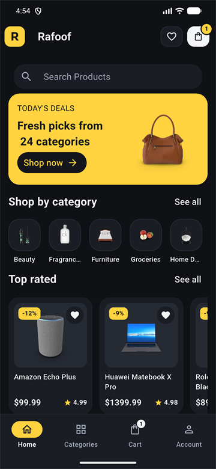
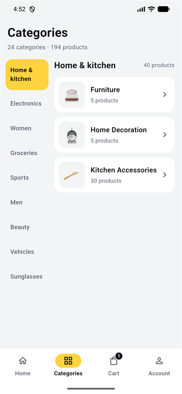
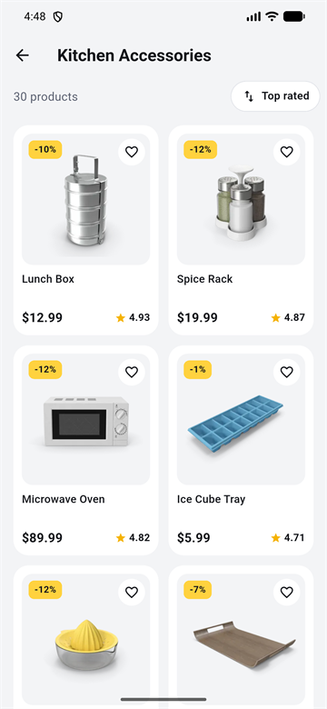
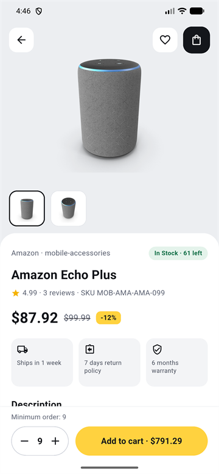
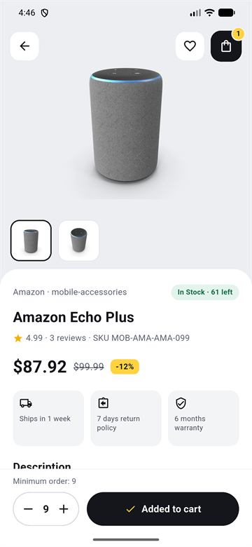
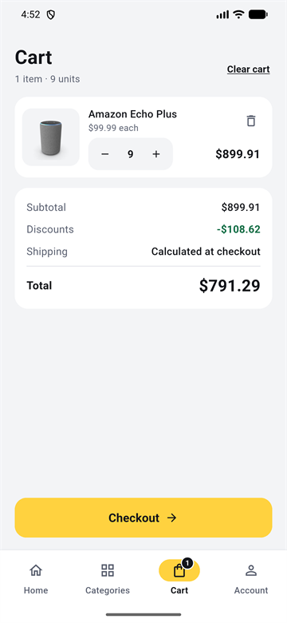
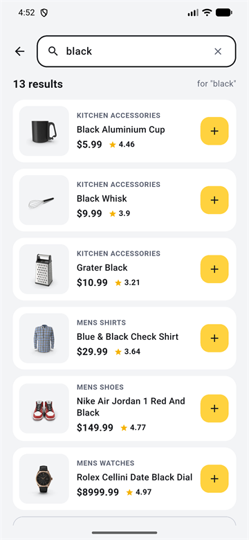
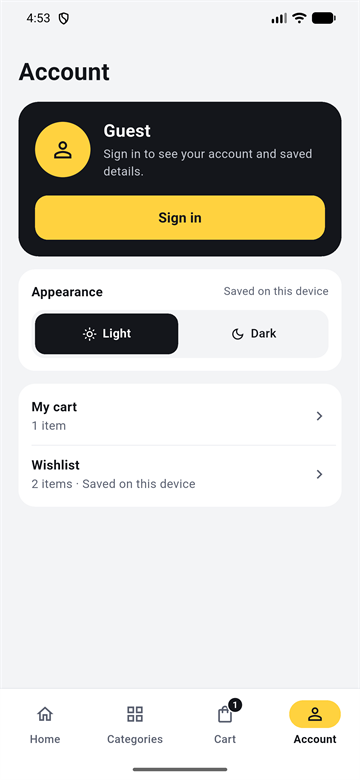
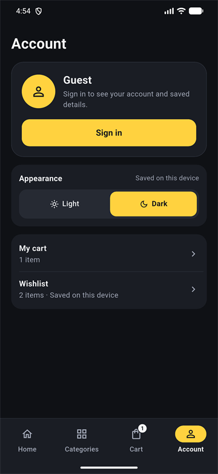
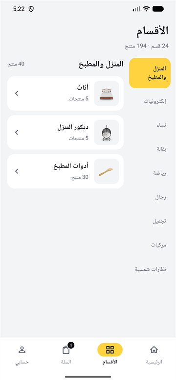

# Rafoof

A general store app built with Flutter on top of the free [DummyJSON](https://dummyjson.com) API.
It has light and dark themes, English and Arabic (right-to-left), Hero transitions between screens and a fly-to-cart animation.

## Screenshots

| Home | Home (dark) | Categories | Products |
| :---: | :---: | :---: | :---: |
|  |  |  |  |

| Product details | Added to cart | Cart | Search |
| :---: | :---: | :---: | :---: |
|  |  |  |  |

| Wishlist | Sign in | Account | Account (dark) |
| :---: | :---: | :---: | :---: |
|  |  |  |  |

| Home (Arabic) | Categories (Arabic) |
| :---: | :---: |
|  |  |

## Features

- **Home**: deal banner, shop by category and top rated products.
- **Categories**: 24 categories in 9 groups, each with its image and product count.
- **Products**: infinite scroll and sorting (top rated, price low/high, name).
- **Product details**: image gallery, Hero transition from the card, stock, minimum order, reviews and a quantity stepper.
- **Fly-to-cart**: the product image flies into the cart button when you add it.
- **Cart**: saved on the device with SQLite. Quantities respect stock and minimum order.
- **Wishlist**: saved on the device with SQLite.
- **Search**: waits for you to stop typing, keeps recent searches and has a "show all" list with sorting.
- **Sign in**: DummyJSON auth with tokens in secure storage. The token renews automatically when it expires.
- **Checkout (demo)**: sends the cart to DummyJSON and shows the order summary.
- **My orders**: every placed order is saved on the device for the signed-in user.
- **Light / Dark theme**: saved on the device.
- **English / Arabic**: the whole interface switches to Arabic with right-to-left layout, including category names and Arabic plural rules.
- **Smooth loading**: cached images, loading skeletons, pull to refresh and a clear message with a retry button when there is no internet.

## Tech stack

| Purpose | Package |
| --- | --- |
| State management | `provider` |
| Networking | `dio`, `pretty_dio_logger` |
| Dependency injection | `get_it` |
| Local database | `sqflite` |
| Local storage | `shared_preferences`, `flutter_secure_storage` |
| Image caching | `cached_network_image` |
| Localization (RTL) | `flutter_localizations` |
| Environment config | `flutter_dotenv` |
| Responsive sizes | `flutter_screenutil` |

## Project structure

```
lib/
├── core/
│   ├── constants/     # English/Arabic strings and app constants
│   ├── database/      # SQLite helper and tables (cart, wishlist, orders)
│   ├── di/            # get_it service locator
│   ├── language/      # LanguageProvider
│   ├── network/       # Dio client, interceptors, endpoints
│   ├── services/      # preferences and auth events
│   ├── shared/widgets/
│   └── theme/         # light and dark colors + ThemeProvider
├── features/
│   ├── account/  auth/  cart/  categories/  checkout/
│   ├── home/  products/  search/  wishlist/
│   │   ├── data/          # models and repositories
│   │   └── presentation/  # pages and providers
└── main.dart
```

## API endpoints

| Endpoint | Used for |
| --- | --- |
| `GET /products` | Top rated, all products, sorting and paging |
| `GET /products/{id}` | Product details and the home banner |
| `GET /products/categories` | Category list |
| `GET /products/category/{slug}` | Products of one category |
| `GET /products/search?q=` | Search |
| `POST /auth/login` · `GET /auth/me` · `POST /auth/refresh` | Sign in, current user, token refresh |
| `POST /carts/add` | Demo checkout |

## Getting started

```bash
git clone https://github.com/aboodmohamd/rafoof.git
cd rafoof
cp .env.example .env.dev
flutter pub get
flutter run
```

Demo account from the DummyJSON docs: **emilys** / **emilyspass**

## Tests

```bash
flutter test
```

26 tests cover the models, the English/Arabic strings, the cart logic (stock and minimum order limits, totals) and the product card widget.

## Release build

```bash
flutter build apk --release --split-per-abi
```

To sign with your own key, create `android/key.properties` (it is ignored by git):

```properties
storePassword=YOUR_STORE_PASSWORD
keyPassword=YOUR_KEY_PASSWORD
keyAlias=upload
storeFile=C:/path/to/upload-keystore.jks
```

Without this file the release build is signed with the debug key.

## Notes

- DummyJSON is a fake API: sign in and checkout work, but nothing is saved on the server.
- The cart and the wishlist are stored only on the device.

## Author

Developed by **Abed Jaber** · [GitHub](https://github.com/aboodmohamd)
